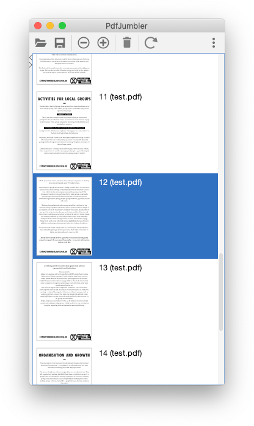

PdfJumbler
==========

PdfJumbler simple tool to rearrange, merge, delete, and rotate pages from PDF files. 

Releases
--------

Releases can be found on the [releases](https://github.com/mgropp/pdfjumbler/releases) page.

Installation
------------
PdfJumbler requires a Java Runtime Environment (JRE), version 21 or above.
You can download one at <https://adoptium.net/>.

Windows users can simply download and run the installer (setup-pdfjumbler.exe),
which creates a start menu entry for PdfJumbler.

For Ubuntu (and probably Debian), you can use this command to install PdfJumbler:
```
curl -L https://raw.githubusercontent.com/mgropp/pdfjumbler/master/setup/ubuntu/install.sh | bash
```

Alternatively, there is a runnable jar file (just double-click), pdfjumbler.jar.


User Interface
--------------



The user interface is actually rather simple:
pages can be moved around using drag&drop (or the
keyboard, see below), and for more complex operations
there's a second page list available to the left
(just pull it out).


Keyboard Shortcuts
------------------
* Ctrl+O       Open file
* Ctrl+S       Save file
* \+           Zoom in
* \-           Zoom out
* Alt+Up       Move page up
* Alt+Down     Move page down
* Del          Delete page
* Ctrl+Z       Undo
* Ctrl+Y       Redo
* Ctrl+R       Rotate clockwise
* Ctrl+Shift+R Rotate counter-clockwise


Command Line
------------
PdfJumbler accepts PDF files as command line arguments.

Several settings can be changed using Java system properties:

* `pdfjumbler.editor`: sets the editor plugin (if installed; previous plugins are no longer supported)
	 * PDFBox: `io.gropp.pdfjumbler.pdfbox.PdfEditor`

* `pdfjumbler.renderer`: sets the renderer plugin (if installed; previous plugins are no longer supported)
	 * PDFBox: `io.gropp.pdfjumbler.pdfbox.PdfRenderer`

* `user.language`: sets the program language (in case auto-detection doesn't work).
	So far, `de` (German), `es` (Spanish), `ru` (Russian) and `en` (English; default)
	localizations are available.

### Example ###
```
java -Duser.language=es -jar pdfjumbler.jar foo.pdf bar.pdf
```


Building from Source
--------------------
Building PdfJumbler requires a Java Development Kit (JDK), version 21 or above.
Gradle is provided through the wrapper, so no separate installation is needed.

```
./gradlew
```

builds the runnable jar file at `build/libs/pdfjumbler.jar`.

Dependency versions are managed in the version catalog, `gradle/libs.versions.toml`.

### Tests ###
```
./gradlew test
```

Tests use JUnit and AssertJ and run headless, so no display is needed.

### Code Style ###
Java sources are formatted with [Palantir Java Format](https://github.com/palantir/palantir-java-format),
applied through [Spotless](https://github.com/diffplug/spotless):

* `./gradlew spotlessCheck` reports formatting violations
* `./gradlew spotlessApply` fixes them

To check formatting automatically before every push, install the Git pre-push hook once:
```
./gradlew installGitHooks
```

### Null Safety ###
All packages are annotated with [JSpecify](https://jspecify.dev/)'s `@NullMarked`, so types are
non-null unless marked `@Nullable`. [NullAway](https://github.com/uber/NullAway) runs as part of
[Error Prone](https://errorprone.info/) during compilation and fails the build on null-safety errors.
